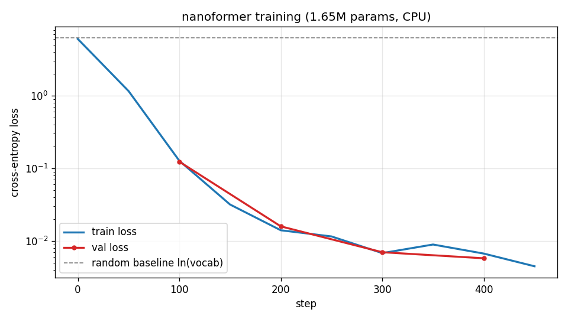

# nanoformer

A small but complete large language model, written from scratch in PyTorch. The
goal is not to chase a benchmark, it is to implement every piece of a modern
decoder-only LLM clearly enough to read, test, and reason about: the
architecture, a trained-from-scratch tokenizer, the training loop, and a
cached inference engine with speculative decoding.

The whole thing is a few hundred lines of dependency-light code, fully tested,
and it trains end to end on a CPU.



*A 1.65M-parameter model trained on CPU. Cross-entropy falls from the random
baseline of ln(vocab) down past 0.01, with validation tracking training.*

## What is implemented

Everything below is written from first principles, not imported from a library.

**Architecture** (`nanoformer/model.py`) follows the LLaMA design:

- **RMSNorm** pre-normalization, computed in float32 for stability
- **Rotary positional embeddings (RoPE)** with a position offset so the same
  code path works for prefill and single-token decode
- **Grouped-query attention (GQA)**: fewer key/value heads than query heads,
  which shrinks the KV cache with no quality loss
- **SwiGLU** feed-forward network
- **Weight tying** between the token embedding and the output head
- Scaled residual initialization (the GPT-2 depth trick)
- An explicit **KV cache** so decoding is O(1) per token instead of O(n)

**Tokenizer** (`nanoformer/tokenizer.py`): a byte-level BPE tokenizer trained
from scratch, GPT-2 style regex chunking, lossless UTF-8 round-trips, special
tokens, and save/load.

**Training** (`nanoformer/train.py`): AdamW with decay applied only to matmul
weights, a cosine learning-rate schedule with linear warmup, gradient
accumulation, gradient clipping, optional mixed precision, evaluation, and
checkpointing.

**Inference** (`nanoformer/generate.py`): temperature, top-k and top-p
(nucleus) sampling, plus a self-contained implementation of **speculative
decoding** where a small draft model proposes tokens and the large model
verifies them in a single pass.

## Results

From `scripts/benchmark.py` (CPU, 6-layer model):

| Method                          | Latency (64 tokens) | Speedup |
| ------------------------------- | ------------------: | ------: |
| Naive, recompute every step     |            ~595 ms  |  1.00x  |
| KV-cached decoding              |            ~220 ms  |  2.71x  |

The speculative decoding test confirms the key correctness property: with a
draft model equal to the target, speculative output is *identical* to greedy
decoding, because every proposed token is the target's own argmax. This is the
guarantee that makes speculative decoding lossless rather than approximate.

A worked end-to-end run (`scripts/train_demo.py`) trains a 1.65M-parameter
model on a small corpus and then samples from the prompt "It was", producing
grammatical, on-distribution continuations.

## Quickstart

```bash
git clone https://github.com/<you>/nanoformer.git
cd nanoformer
pip install -r requirements.txt

# train a tiny model end to end (runs on CPU, no downloads needed)
python scripts/train_demo.py --steps 1500

# benchmark the inference engine
python scripts/benchmark.py

# run the test suite
pytest
```

Train on your own text by passing a file:

```bash
python scripts/train_demo.py --input your_corpus.txt --steps 3000 --dim 256 --layers 6
```

## Library usage

```python
from nanoformer import BPETokenizer, ModelConfig, Transformer, generate
import torch

tok = BPETokenizer()
tok.train(open("corpus.txt").read(), vocab_size=2048)

model = Transformer(ModelConfig(vocab_size=tok.vocab_size, dim=256, n_layers=6))
# ... train with nanoformer.Trainer ...

prompt = torch.tensor([tok.encode("Once upon a time")])
out = generate(model, prompt, max_new_tokens=100, temperature=0.8, top_k=40)
print(tok.decode(out[0].tolist()))
```

## Project layout

```
nanoformer/
  model.py        # RMSNorm, RoPE, GQA attention, SwiGLU, Transformer, KV cache
  tokenizer.py    # byte-level BPE, trained from scratch
  train.py        # cosine schedule, AdamW, Trainer, checkpointing
  generate.py     # sampling + speculative decoding
  data.py         # tokenized dataset and batching
tests/            # 25 tests incl. KV-cache equivalence + speculative correctness
scripts/          # train_demo.py, benchmark.py
```

## Tests

```bash
pytest -q
```

The suite covers shapes and loss sanity, RMSNorm scaling, RoPE norm
preservation, GQA head expansion, tokenizer round-trips and persistence,
sampling filters, and two correctness invariants worth calling out:

- **KV-cache equivalence**: step-by-step cached decoding produces logits
  identical to a single full forward pass.
- **Speculative == greedy**: speculative decoding with `draft == target`
  reproduces greedy decoding exactly.

## Notes and references

The design draws on a handful of papers: RoPE (Su et al., 2021), RMSNorm
(Zhang and Sennrich, 2019), GQA (Ainslie et al., 2023), SwiGLU (Shazeer,
2020), and speculative decoding (Leviathan et al., 2023). The implementation
is original and kept deliberately small so each idea is easy to find and read.

## License

MIT. See [LICENSE](LICENSE).
